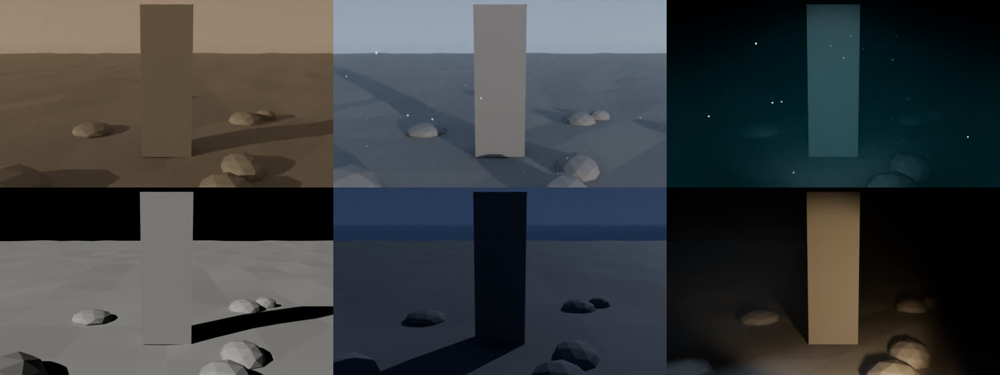

# Visual Style Guide — Stranger Horizons

**Status:** v1.0 proposed (Stage 3). Awaiting owner approval. Replaces the initial working direction.
**Inputs:** `docs/CHANNEL_BIBLE.md`, `REFERENCE_VIDEO_ANALYSIS.md`, `BLENDER_TECHNIQUE_NOTES.md`.
**Companion guides:** `CINEMATOGRAPHY_GUIDE.md` · `LIGHTING_GUIDE.md` · `ENVIRONMENT_GUIDE.md` · `AUDIO_STYLE_GUIDE.md`
**Machine-readable source of truth:** `config/visual_style.json`, `config/presets/*.json`, `config/camera_presets.json`, `config/render_config.json`. If a number in this document disagrees with a config file, the config file wins and this document gets fixed.

---

## 0. The identity in one paragraph

Stranger Horizons looks like an **expedition camera that went somewhere hard to reach**. Frames are dark but never murky, cool by default, and lit by sources that would really be there. The camera moves slowly and with intent. One accent colour per frame points the eye. Graphics are quiet, precise and labelled, and every reconstruction says that it is one. The mystery comes from what we don't know, never from tricks.

**Five rules that hold across every topic:**
1. **Motivated light.** Every light has a source the viewer could name.
2. **One accent per frame:** Signal Cyan *or* Ember Amber, never both as accents.
3. **Readable on a phone.** The focal subject sits above deep shadow and holds for at least 1.5 s.
4. **Slow, eased camera.** No handheld shake, no snap zooms.
5. **Honest pixels.** Reconstructions carry an on-screen label, and nothing is shown that the sources don't support.

These rules are what make a deep-ocean episode and a UAP episode feel like the same channel.

*Look-dev v1 (Cycles, 24 samples, neutral grey test set, not production imagery). Top: Ancient Civilizations, Antarctica, Deep Ocean. Bottom: Space & Cosmic, UAP Visualization, Underground. Rendered with `blender/scripts/sh_preset_preview.py`.*

---

## 1. Colour palette and grading

### 1.1 Core palette

| Token | Hex | Role |
|---|---|---|
| Abyss Navy | `#0B1622` | Base shadow colour; graphic backgrounds |
| Charcoal | `#15181C` | Neutral dark; letterbox and title cards |
| Slate | `#2B3540` | Mid-dark surfaces; graphic panels |
| Mist | `#8C9AA6` | Secondary text; atmospheric mid-tones |
| Bone | `#E8E4DC` | Primary text; highlights (warm white, never pure #FFFFFF) |
| **Signal Cyan** | `#4FD1D9` | Accent: technology, signals, water, data, bioluminescence |
| **Ember Amber** | `#E0A04A` | Accent: human presence, fire and lamps, history, warmth |

Topic environments add their own natural colours (ice blue, sandstone, cave ochre). The palette above governs **shadows, highlights, accents and all graphics**.

### 1.2 Evidence-label colours (graphics only)

These match the six labels in `docs/RESEARCH_STANDARDS.md` and are used on evidence cards and label chips (§9).

| Label | Chip style |
|---|---|
| Established fact | Bone fill, Charcoal text |
| Strong evidence | Signal Cyan outline, Bone text |
| Hypothesis | Ember Amber outline, Bone text |
| Disputed | Split chip: half Cyan / half Amber outline |
| Unverified report | Mist dashed outline, Mist text |
| Speculation | Ember Amber dashed outline, italic Bone text |

Colour is never the only carrier of meaning: every chip also prints the label word.

### 1.3 Grading pipeline

| Stage | Standard |
|---|---|
| Scene-referred render | Linear, Blender **AgX** view transform, Look **Medium High Contrast** (set by presets) |
| Exposure | Per preset, within ±1 EV of base |
| Shadows | Lifted slightly toward Abyss Navy. Never crushed to pure black except in vacuum (space) |
| Highlights | Roll off softly (AgX). No clipped white areas larger than a light source |
| Saturation | Restrained. Natural colours at roughly 80–90% of "real"; accents may reach full strength in small areas |
| Delivery | Rec.709 / sRGB, tagged BT.709 by `pipeline/assemble_video.py` |
| Consistency check | Before final render, place shots of one sequence side by side and match mean exposure and shadow tint |

**Avoid:** teal-and-orange blockbuster grading across the whole frame, heavy vignettes, crushed horror blacks, bleach bypass, artificial film-damage overlays.

---

## 2. Cinematic lighting standards

Summary only; full rules in `LIGHTING_GUIDE.md`.
- One clear key per shot, motivated by a nameable source (sun, moon, lamp, opening, bioluminescence).
- Fill comes from the environment (sky, bounce, water) and stays at least 2 stops under the key.
- Volumetric shafts only where there is a medium (water, haze, dust), **never in vacuum**.
- The accent light or emitter matches the frame's accent colour.

## 3. Camera language and movement presets

Summary only; full rules in `CINEMATOGRAPHY_GUIDE.md`.
- **Default move:** slow push-in. **Signature opener:** descent reveal (above → through an occluding layer → subject).
- Lenses: 24–35 mm for environments and underwater, 50–85 mm for observation and compression, 85 mm+ for "surveillance/observation" feel (UAP).
- Presets in `config/camera_presets.json`: `static_hold`, `slow_push_in`, `descent_reveal`, `aerial_reveal`, `rise_reveal`, `lateral_track`, `controlled_orbit`, `over_shoulder_reveal`. Built in Blender by `blender/scripts/sh_camera.py` with eased Bezier keys and a hold on the final framing.

## 4. Environment design standards

Summary only; full rules in `ENVIRONMENT_GUIDE.md`. Every environment has three depth layers (foreground occluder, mid-ground subject, background dissolving into atmosphere), at least one scale cue of known size, and only features that the sources support.

## 5. Realistic materials and textures

| Rule | Standard |
|---|---|
| Shading model | Principled BSDF, physically plausible values: dielectric base colour roughly sRGB 30–240, metallic either 0 or 1 |
| Texture sources | CC0 libraries (e.g. Poly Haven) or original scans; every download recorded in `assets/asset_register.json` |
| Texel density | Consistent within a shot; nothing should look blurry next to something sharp at the same distance |
| Roughness | Never perfectly 0 or 1. Use roughness maps to break up reflections |
| Weathering | Edge wear, dirt in crevices, sediment or ice accumulation on upward faces. Driven procedurally (ambient occlusion / pointiness / Z-up masks) where possible |
| Scale | Model in real metres. Noise and texture scales follow real-world size (rock grain ≠ boulder size) |
| Neutral check | Look-dev on 18% grey (`sh_preset_preview.py`) before applying final textures |

## 6. Atmospheric and volumetric effects

| Medium | Preset `volume.kind` | Standard |
|---|---|---|
| Water | `water` | Principled Volume scatter + Volume Absorption tinted blue-green (red absorbed first). Forward scattering (anisotropy 0.6–0.8) for visible lamp beams |
| Fog / haze | `haze` / `fog` | Height falloff (dense near ground), low-frequency noise. Density chosen so the far background is about 70–90% veiled |
| Dust | `dust` | Warm grey, moderate forward scatter, only in enclosed or dry spaces |
| Vacuum | `none` | No volume, no shafts, no glow halos except from emitting matter |

Particles (marine snow, snow, dust) come from the preset's `particles` block: small, sparse, slow. They are there to show depth and motion, and they never fill the frame like a snow globe.

## 7. Animation principles

1. **Slow by default.** Camera speed is chosen so a viewer can track the subject without effort. Typical push-in is 20–30% of subject distance over 6–10 s.
2. **Ease everything.** Bezier ease-in and ease-out on every key; no linear starts or stops.
3. **Hold to read.** The final framing holds at least 1.5 s (presets include `hold_s`).
4. **Natural secondary motion only:** drifting particles, swaying kelp, blowing snow, flickering lamps. No unmotivated object motion.
5. **Physically plausible timing.** Large things move slowly. Water slows everything. Ice and stone don't move.
6. **No fake camera shake.** The only allowed drift is below 2 cm of amplitude, so it feels alive, not handheld.
7. **Reconstructed motion of real events** (vehicles, witness-described objects) follows the source description and is labelled.

## 8. Scene transitions

| Transition | When | Duration |
|---|---|---|
| **Cut** | Default within a sequence | — |
| **Dissolve** | Time passes or place changes within a chapter | 12–24 frames (0.4–0.8 s) |
| **Dip to Charcoal** | Chapter change (the seven story beats in `CHANNEL_BIBLE.md`) | 0.5 s out + 0.5 s in |
| **Match cut** | Shape or motion continuity across topics (e.g. sonar ring → radar ring) | Cut |
| **Depth push** | Camera pushes into a dark area or occluder, next shot starts emerging from darkness | Cut hidden in the dark frame |

**Never:** glitch wipes, flashes, whip pans with blur, spinning 3D transitions, or "jump-scare" hard cuts timed to sound hits.

## 9. Documentary motion graphics

Graphics are quiet, precise and labelled.

| Element | Standard |
|---|---|
| **Reconstruction label** | Top-left chip, Bone text on 60% Charcoal: `ILLUSTRATIVE RECONSTRUCTION`, `ARTIST'S IMPRESSION`, `DATA VISUALIZATION`, or `NOT TO SCALE`. Required whenever the storyboard `reconstruction_status` is not footage; text comes from `on_screen_label` |
| **Source citation** | Lower-left, small Mist text: `Source: <organisation>, <year>`. Appears when a fact is stated on screen or a chart/map is shown |
| **Evidence card** | Slate panel, label chip (§1.2), one-sentence claim. For the Investigation and Possibilities beats |
| **Maps** | Dark Abyss Navy land, Slate water (or the reverse for ocean topics), single accent for the subject location, thin Mist graticule. Projection and scale bar shown |
| **Timelines** | Thin Mist line, Bone ticks, accent dot on the current event |
| **Data charts** | Flat, no 3D bars, no drop shadows; axis labels in Bone; one accent series, others in Mist |
| **Motion** | Elements fade or slide 8–16 px with easing over 10–15 frames. No bounces or overshoots |
| **Safe areas** | Title-safe 90% of frame, and keep critical text out of the bottom 15% where YouTube's player controls appear |
| **Original vs. illustration** | Original source material (photos, sensor frames, documents) is shown in a thin Bone frame with its credit. CGI never wears that frame |

## 10. Typography and title design

All proposed fonts are under the SIL Open Font License. Confirm the licence at download and record each in `assets/asset_register.json`.

| Use | Typeface | Style |
|---|---|---|
| Episode title, chapter titles | **Barlow Condensed** SemiBold | UPPERCASE, letter-spacing +8–12%, Bone |
| Body labels, lower-thirds, cards | **Inter** Regular / Medium | Sentence case, Bone or Mist |
| Data, coordinates, timestamps | **IBM Plex Mono** Regular | Mist, tabular figures |
| Thumbnail headline | Barlow Condensed Bold | 2–4 words max, UPPERCASE |

| Size (1080p frame) | Minimum |
|---|---|
| Chapter title | 72 px cap height |
| Lower-third / card text | 40 px |
| Citation / chip text | 28 px |
| Subtitles (burnt-in Shorts) | 48 px, with 60% Charcoal box |

**Title card:** chapter number in IBM Plex Mono (`02 / 07`), title in Barlow Condensed, on Charcoal or over a dark plate. Holds 2 s, fades in over 12 frames.

## 11. Sound design direction

Summary only; full rules in `AUDIO_STYLE_GUIDE.md`. Narration first, calm and clear. Music is atmospheric and sparse, never horror stings. Effects are realistic and motivated by what is on screen. Delivery target is −14 LUFS integrated, ≤ −1 dBTP.

## 12. Rendering standards

| Profile (`render_config.json`) | Resolution | Engine | Use |
|---|---|---|---|
| `preview` | 1280×720, 8-bit PNG | EEVEE (resolved per Blender version) | Blocking, timing, approvals |
| `delivery` | 1920×1080, 16-bit PNG | Cycles, GPU, denoised | Final long-form |
| `master` | 3840×2160, 16-bit PNG | Cycles | When hardware and time allow |
| `shorts` | 1080×1920, 16-bit PNG | EEVEE | Vertical re-frames |

- 30 fps unless the story needs otherwise.
- **Image sequences are masters**; MP4 is encoded separately (`pipeline/assemble_video.py`: H.264, yuv420p, BT.709 tags, CRF 18).
- Every render writes `render_log.json` (Blender version, engine, samples, resolution, frame range) via `blender/scripts/sh_render.py`.
- **Before any render:** `pipeline/check_environment.py`, then `sh_env_check.py` inside Blender.
- **QA:** no fireflies or flicker in volumes (raise samples or volume step rate), no clipping of the camera into geometry, no black frames, and the reconstruction label is present where required.

---

## Quality gate (every shot)

1. Is the focal idea clear in under 2 seconds?
2. Is the subject readable on a phone screen?
3. Does scale feel believable, and is there a scale cue?
4. Is every light and every camera move motivated?
5. Is there exactly one accent colour?
6. **Could this CGI be mistaken for authentic footage?** If yes, it needs the label, or it needs to change.
7. Does it match the topic preset and this guide?
