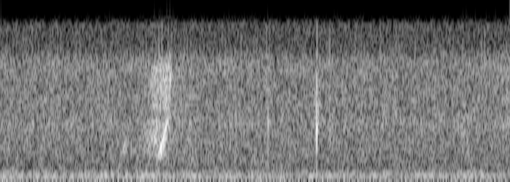

# Audio analysis — NOAA source files (2026-11-26)

Files downloaded by the owner from NOAA PMEL into `audio/source_noaa/` (not in git; U.S. government works).

| File | Source page | Stated speed-up | Duration | Format | Peak / RMS | Notes |
|---|---|---|---|---|---|---|
| bloop.wav | pmel.noaa.gov/acoustics/sounds/bloop.html | 16× | 10.34 s (≈ 165 s original) | PCM 16-bit, 8 kHz, mono | −0.2 / −26.9 dBFS | md5 c5226273efefafa435d30cd064a5f58d |
| A53JD33Calving_3x.wav | same page | 3× | 282.2 s (≈ 14 min original) | PCM 16-bit, 8 kHz, mono | 0.0 / −24.0 dBFS | 1 clipped sample. Name suggests iceberg A53a, day 33 (inference, not stated on the page) |
| HarmonicTremor2006_215_09_20UsedOnBloopWebsite.wav | same page | 3× | 138.9 s | PCM 16-bit, **999 Hz**, mono | −6.9 / −19.6 dBFS | Unusual sample rate; resample to 48 kHz for editing |
| julia_sound.wav | pmel.noaa.gov/acoustics/sounds/julia.html | 16× | 10.34 s | PCM 16-bit, 8 kHz, mono | −0.2 / −16.2 dBFS | |
| noise97139.wav (Slow Down) | pmel.noaa.gov/acoustics/specs_cryogenic.html | 16× | — | — | — | **Download failed (0 bytes); re-download** |

## bloop.wav: what the file shows



*Spectrogram we computed from NOAA's file (512-point FFT, hop 64, 0–900 Hz in file frequency). Time runs left to right across the 10.34 s clip.*

- Energy in the file sits below about 800 Hz, i.e. below about 50 Hz at true speed (÷16).
- The main event is a burst at about 3.0–3.5 s of the clip, with a clearly **rising** sweep from roughly 150 to 450 Hz in the file. At true speed that is roughly **9 → 28 Hz**, lasting roughly **8 s**. A weaker, short broadband pulse follows at about 6.6 s.
- The energy envelope (100–800 Hz, 0.25 s steps) is flat within about 3 dB except at 3.0–3.5 s (+11 to +17 dB) and around 6.25 s (+12 dB).

## Caveats

- This is our own non-specialist measurement of a web copy, and it assumes the stated 16× factor is exact.
- NOAA describes the Bloop as rising "over about one minute". The main burst in this file is shorter (~8 s at true speed). The web file may be an excerpt, filtered, or a different detection; we therefore keep NOAA's description attributed to NOAA and do not present our durations as NOAA's (claims C05, C47).
- About 20 Hz is a commonly cited lower limit of human hearing; much of the true-speed sweep sits near or below it, which is consistent with why NOAA published a sped-up version.

## Reproduce

```
python3 - <<'PY'
import wave, numpy as np
w = wave.open("audio/source_noaa/bloop.wav"); sr = w.getframerate()
x = np.frombuffer(w.readframes(w.getnframes()), np.int16).astype(float)
n, hop = 512, 64
S = np.array([np.abs(np.fft.rfft(x[i:i+n]*np.hanning(n))) for i in range(0, len(x)-n, hop)]).T
print(sr, len(x)/sr, S.shape)
PY
```
